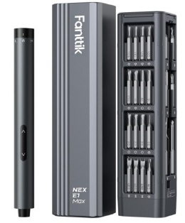
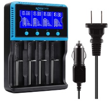
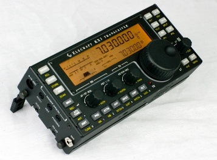

  
<b>Click the ticket to see the raffle prizes! </b>

  <table>
    <tr>
        <th>5th prize</th>
        <th>4th prize</th>
        <th>3rd prize</th>
        <th>2nd prize</th>
        <th>1st prize</th>
    </tr>
    <tr>
        <td></td>
        <td></td>
        <td></td>
        <td></td>
        <td></td>
    </tr>
    <tr>
        <td>Cordless Electric Scissors / Rotary Cutter</td>
        <td>Window Clip Mount for Handheld Antenna</td>
        <td>Fanttik E1 Max Electric Screwdriver, 53-in-1 Screwdriver</td>
        <td>10-Pack Eneloop Panasonic Ni-MH Rechargeable Batteries plus Universal Battery Charger</td>
        <td>The Elecraft KX3 is an ultra-compact, all-mode Software-Defined Radio (SDR) QRP amateur radio transceiver</td>
    </tr>
  </table>

